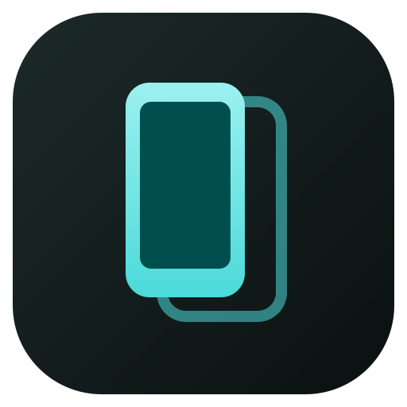

<p align="center">
  
</p>

<h1 align="center">Scrcpy Viewer</h1>

<p align="center">
  A desktop app for mirroring and controlling Android devices, built on the
  <a href="https://github.com/Genymobile/scrcpy">scrcpy</a> protocol with Compose Multiplatform.
</p>

---

## What it is

Running [scrcpy](https://github.com/Genymobile/scrcpy) usually means typing a command in a terminal and remembering
which flags you want. Scrcpy Viewer replaces that with a desktop app: a live list of connected devices, a searchable
list of every scrcpy option as checkboxes, and saved presets you can share.

It is not a wrapper around the `scrcpy` program. The app includes its own scrcpy client. It talks to `scrcpy-server`
directly, decodes the video with FFmpeg, and draws it in a window the app owns. scrcpy-server and adb come bundled,
so you do not need to install scrcpy, adb or FFmpeg.

## Features

### Devices
- **Live device list.** Uses adb's `track-devices` stream, so devices appear and disappear as they connect. You never
  need to press refresh.
- **Device states.** Shows each device as ready, unauthorized (accept the prompt on the phone), or offline.
- **Wi-Fi debugging.** Pair a device with a QR code, a pairing code, or an IP address. You can also right-click a USB
  device to switch it to Wi-Fi. Devices on the network are found through mDNS, with a `dns-sd` fallback on macOS.
- **Restart adb** from the app when the adb server gets stuck.

### Options and presets
- **Every scrcpy 5.0 option** as a checkbox. Options that take a value add a text field or dropdown.
- **Search and filter** options by group: Video, Audio, Control, Device, Window, Recording, Camera, Virtual display
  and Connection.
- **Generated command.** Shows the equivalent `scrcpy -s <serial> …` command line, with a copy button.
- **Per-device options.** Each device remembers its own options.
- **Presets.** Save, edit, duplicate, delete and apply presets, and set one as the default for new devices.
- **Import and export** presets as `.scrcpypresets.json` files or pasted JSON. When an imported name already exists,
  you choose Replace, Keep both or Skip.

### Mirroring
- **Several mirror windows at once**, one per device.
- **Mouse and keyboard input**, including scrcpy's UHID keyboard and mouse modes.
- **Navigation buttons:** Back, Home, Recents, Volume up/down, Rotate and Power.
- **Audio playback** from the device.
- **Screenshots and screen recordings**, saved to a capture folder you choose in Settings.
- **Zoom** from 25% to 400%, plus fit to window.
- **Drag and drop files.** Drop an APK to install it. Other files go to `/sdcard/Download/`.
- **Reconnect.** If a device disconnects, the window keeps the last frame and offers Reconnect when the device returns.

### App
- Material 3 theme, light and dark.
- Custom title bar, with an option to use the system title bar instead.
- First-run welcome guide. You can reopen it from Settings.
- Uses the bundled adb by default, or a custom adb path you choose.

## Download

Installers for each release are on the [Releases](https://github.com/jakepurple13/ScrcpyViewerV2/releases) page:

| Platform | File   |
|----------|--------|
| macOS    | `.dmg` (the `.zip` is for the in-app updater) |
| Windows  | `.exe` (NSIS installer, per user) |
| Linux    | `.deb` |

The app checks for updates when it opens and can install them itself (Settings > Updates).

> **macOS:** the builds are not signed. The first time you open the app, right-click it and choose **Open**. When
> macOS asks for Local Network access, allow it. Wi-Fi debugging does not work without it.

## Getting started

1. On the Android device, turn on **Developer options**, then turn on **USB debugging**.
2. Connect the device with USB, or pair it over Wi-Fi from the Devices screen.
3. Accept the "Allow USB debugging" prompt on the device.
4. Double-click the device. Or select it, change options, and press **Mirror**.

## Tech stack

| Area           | Technology                                                                                      |
|----------------|-------------------------------------------------------------------------------------------------|
| Language       | Kotlin 2.3 (JVM target only)                                                                    |
| UI             | Compose Multiplatform 1.12 for Desktop, Material 3, Material Icons Extended                     |
| Navigation     | Jetpack Navigation 3 and Material 3 Adaptive (list-detail panes)                                |
| Window chrome  | [Jewel](https://github.com/JetBrains/jewel) decorated window                                    |
| Video decoding | FFmpeg 8.1 through [JavaCPP presets](https://github.com/bytedeco/javacpp-presets) (`org.bytedeco:ffmpeg`) |
| Device link    | Bundled adb (Android platform-tools) and scrcpy-server 5.0, using the adb wire protocol over sockets |
| Concurrency    | kotlinx.coroutines                                                                              |
| Serialization  | kotlinx.serialization (JSON settings and presets)                                               |
| QR codes       | [QRose](https://github.com/alexzhirkevich/qrose) (Wi-Fi pairing)                                |
| Runtime        | JetBrains Runtime 25 (compiled with JDK 21 toolchain)                                           |
| Build          | Gradle (Kotlin DSL) with version catalog, [Nucleus](https://nucleusframework.dev) packaging (electron-builder) |
| Updates        | Nucleus updater (`latest-*.yml` metadata on GitHub releases)                                     |
| CI             | GitHub Actions: tests on macOS, Windows and Linux; installers built and released on `v*` tags |

## How it works

1. **Device tracking.** The app connects to the adb server on `localhost:5037` and sends `host:track-devices-l`. If no
   server is running, it starts one with the bundled adb.
2. **Starting a session.** For each mirror window, the app pushes `scrcpy-server` to the device and sets up an
   `adb reverse` tunnel (or `adb forward` as a fallback). It then launches the server with `app_process`, passing your
   options as server arguments.
3. **Video.** The app reads the H.264/H.265/AV1 stream from the video socket and decodes it with FFmpeg. It then draws
   each frame in a Compose canvas, scaled to keep the aspect ratio.
4. **Audio.** The app plays the audio socket through Java Sound.
5. **Control.** Mouse, keyboard and scroll events become scrcpy control messages. Window coordinates are mapped to
   device coordinates using the current frame size.

Closing a mirror window closes its sockets. This stops the server on the device and removes the tunnel.

## Building from source

Requirements: JDK 21 or newer. Gradle downloads JetBrains Runtime 25 automatically when you run or package the app.
Packaging also needs Node.js (24 in CI): the Nucleus plugin builds the installers with electron-builder.

```bash
# Run the app (downloads scrcpy-server and adb into composeApp/bundled on first run)
./gradlew :composeApp:run

# Run the unit tests
./gradlew :composeApp:jvmTest

# Screenshot tests (slow, offscreen rendering)
./gradlew :composeApp:jvmTest -Pscreenshots

# Real-device tests (needs attached devices)
./gradlew :composeApp:jvmTest -PdeviceTests -PdeviceSerials=<serial1,serial2>

# Build an installer for the current OS
# (macOS: DMG + ZIP, Windows: NSIS .exe, Linux: .deb, each with latest-*.yml)
./gradlew :composeApp:packageDistributionForCurrentOS
```

The `downloadBundledTools` task fetches scrcpy-server v5.0 (checked against its SHA-256) and the latest Android
platform-tools adb for each OS.

## Project layout

```
composeApp/src/jvmMain/kotlin/com/programmersbox/scrcpyviewer/
├── adb/        adb wire protocol client, device tracking, Wi-Fi pairing and mDNS discovery
├── scrcpy/     scrcpy-server launcher, stream protocol, control and device messages
├── media/      FFmpeg video decoding, audio playback, screenshots and recording
├── options/    scrcpy option catalog, values and command-line / server-argument generation
├── presets/    preset model, JSON codec, storage and import planning
├── state/      app settings and per-device option storage
├── files/      file push and APK install
├── tools/      bundled adb and scrcpy-server lookup
└── ui/         Compose screens: devices, mirror, presets, settings, onboarding, window chrome, theme
```

## Data location

Settings, presets and per-device options are stored as JSON in:

| OS      | Path                                                         |
|---------|--------------------------------------------------------------|
| macOS   | `~/Library/Application Support/ScrcpyViewer`                 |
| Windows | `%APPDATA%\ScrcpyViewer`                                     |
| Linux   | `$XDG_DATA_HOME/ScrcpyViewer` (default `~/.local/share/ScrcpyViewer`) |

Set the `scrcpyviewer.dataDir` system property to use a different folder.

## Acknowledgements

- [scrcpy](https://github.com/Genymobile/scrcpy) by Genymobile, whose server this app bundles and whose protocol it
  implements.
- [Android platform-tools](https://developer.android.com/tools/releases/platform-tools) for adb.
- [FFmpeg](https://ffmpeg.org/) and [JavaCPP](https://github.com/bytedeco/javacpp) for video decoding.
